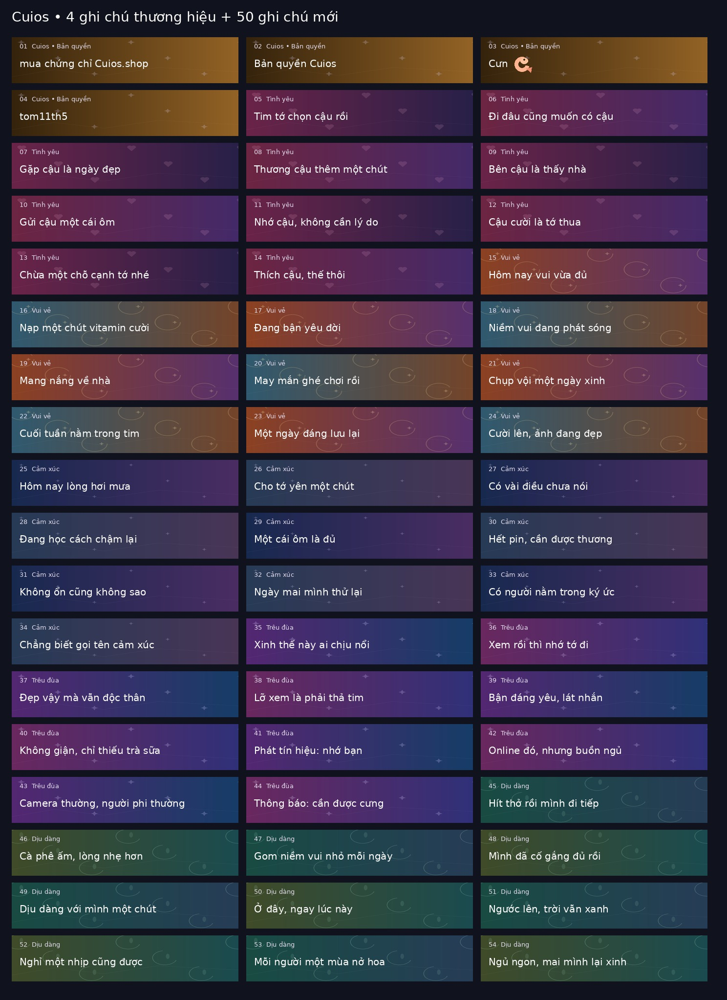

# Cuios • Locket 60s / 100 MB • v3.0.0

Dự án mới **locket60s_amthanh_mic**, nhân bản từ [locket30s-fixed](https://github.com/Cuongqtx11/locket30s-fixed) tại commit `6dd3f5dc8c84311f236aaa92af49822ad59b81e5`. Repo cũ giữ nguyên. Dự án này dùng URL module, script và ảnh riêng; không cần cập nhật repo cũ để chạy.

Người dùng đã xác nhận bản gốc có mic, quay 60 giây, nhập video tối đa 10 giây/6 MB và ghi chú mới. v3 kế thừa phần đó; **chưa xác nhận trên iPhone việc nhập/gửi đủ 60 giây/100 MB, nền ảnh hoặc khung mới**. Kiểm thử offline không chứng minh máy chủ Locket chấp nhận upload.

## Cài trên Shadowrocket

Tắt module Locket cũ, chỉ bật một module của bản mới. Giữ MITM/CA đang hoạt động, tải lại script sau khi cập nhật, tắt/bật kết nối và đóng hẳn rồi mở lại Locket.

Bản chính dùng khung **Aura tím hồng**:

```text
https://raw.githubusercontent.com/Cuongqtx11/locket60s_amthanh_mic/main/locket60s_amthanh_mic.sgmodule
```

| Lựa chọn | Link module đầy đủ |
| --- | --- |
| Aura | [locket60s_amthanh_mic.sgmodule](https://raw.githubusercontent.com/Cuongqtx11/locket60s_amthanh_mic/main/locket60s_amthanh_mic.sgmodule) |
| Gold | [locket60s-gold.sgmodule](https://raw.githubusercontent.com/Cuongqtx11/locket60s_amthanh_mic/main/locket60s-gold.sgmodule) |
| Rose | [locket60s-rose.sgmodule](https://raw.githubusercontent.com/Cuongqtx11/locket60s_amthanh_mic/main/locket60s-rose.sgmodule) |
| Giữ khung hiện tại | [locket60s-no-widget.sgmodule](https://raw.githubusercontent.com/Cuongqtx11/locket60s_amthanh_mic/main/locket60s-no-widget.sgmodule) |

Các link là module thay thế nhau, không bật đồng thời. Các tên locket60s.sgmodule, locket30s.sgmodule và locket60s-widget.sgmodule trong repo mới là alias của bản Aura; chúng không sửa repo cũ.

## Video 60 giây, 100 MB và âm thanh

### Nếu đã xoá/cài lại module nhưng vẫn nghi dùng mã cũ

Dùng [locket60s-refresh.sgmodule](https://raw.githubusercontent.com/Cuongqtx11/locket60s_amthanh_mic/main/locket60s-refresh.sgmodule) thay cho module hiện tại. Bản Refresh r1 dùng tên rule riêng và URL script gắn commit `9bb85e7`, khác URL main để loại trừ đường dẫn script đã lưu. Nó chạy cùng mã v3.0.0, không thay tính năng và không tự xoá dữ liệu Locket. Bản này cố định tại v3.0.0, không tự nhận các thay đổi script tương lai từ main.

Xoá module trong Shadowrocket không xoá cache Remote Config bên trong Locket. Tắt mọi module Locket khác, bật kết nối trước khi mở Locket và tìm log có `firebase: v3.0.0` cùng `captions=54`. Nếu có log nhưng UI vẫn cũ, cần kiểm tra bước activate/schema phía app; nếu không có log thì chưa quan sát được response Firebase qua script này.

Firebase có fetch interval và activate riêng: [tài liệu chính thức](https://firebase.google.com/docs/remote-config/ios/get-started). Proxy không tự gọi được phương thức xoá cache/fetch/activate bên trong app. Không gỡ Locket hoặc reset quyền riêng tư chỉ để xử lý cache script.

- Giữ các cờ mic/âm thanh của bản 2.1 mà người dùng đã thử thành công.
- Đồng bộ thời lượng camera, thư viện, cắt và các cấu hình upload có sẵn về 60 giây.
- Bổ sung giới hạn file ở camera_roll và các key entry tương ứng, xử lý các nhóm media có tên được hỗ trợ như gold/free/upload/limits nếu có trong response.
- 100 MB ở đây dùng cách tính nhị phân phổ biến trong module: **104857600 bytes = 100 MiB**; không nhầm số giây với mili-giây hoặc byte với MB.
- Giữ codec, bitrate, cache ảnh, bucket/CDN và dữ liệu upload thực tế. Chỉ xử lý response cấu hình, không đọc/gửi file riêng của người dùng.

`max-size=1048576` trong module là giới hạn body **JSON cấu hình** cho script, không phải giới hạn video; không cần tăng nó lên 100 MB. Các request video/storage không bị script buffer hay viết lại.

Nếu vẫn thấy 10 giây/6 MB, xem dòng `diag v3.0.0 input library limits` để đối chiếu key thực, và dòng `firebase: v3.0.0 config target=60s; upload-bytes=104857600; captions=54`. Nếu chọn đủ clip nhưng gửi bị từ chối, cần mã lỗi upload thật; nâng giới hạn UI không thay chính sách máy chủ. [Phân tích kỹ thuật](docs/UPGRADE-v3.md).

## 4 ghi chú thương hiệu + 50 mẫu mới

Thay danh sách ghi chú trong picker bằng đúng 54 mẫu. Không xoá hay sửa chú thích của bài đã gửi.

Bốn mẫu đầu, đúng thứ tự yêu cầu:

1. mua chứng chỉ Cuios.shop
2. Bản quyền Cuios
3. Cưn🍤
4. tom11th5

Bên dưới là 5 nhóm, mỗi nhóm 10 mẫu: **Tình yêu, Vui vẻ, Cảm xúc, Trêu đùa, Dịu dàng**. Cả ID lẫn danh sách đăng ký được thay mới, không giữ bộ ghi chú cũ trong picker. Mỗi ghi chú có gradient màu dự phòng và ảnh nền PNG tự thiết kế, lấy từ chính repo này. Không thêm quảng cáo, tracker hoặc tài nguyên ảnh của bên thứ ba.



Danh mục chỉnh được nằm ở [content/captions.json](content/captions.json). Ảnh preview chỉ minh hoạ nội dung/bố cục, không phải screenshot Locket; emoji do iOS render có thể khác bản xem trước.

## Khung ngay trên widget gốc

Dùng `widget_frame_event` với PNG viền trong suốt để thử trang trí widget Locket có sẵn. Ba thiết kế có gradient, quầng sáng và các ngôi sao; tâm ảnh trong suốt để giữ nội dung ảnh. Module không tạo một widget thay thế.

| Aura | Gold | Rose |
| --- | --- | --- |
|  |  |  |

Đây là **hiệu ứng hình ảnh tĩnh**, không tuyên bố hoạt ảnh/chớp sáng. Việc native widget có đọc event, chọn placement và cập nhật timeline hay không còn phụ thuộc phiên bản Locket/iOS. Nếu không hiện hoặc bố cục không phù hợp, dùng module no-widget và giữ các phần video/ghi chú.

## Quay lại bản ổn định

Tắt module mới và bật lại module của repo locket30s-fixed. Source/module cũ không thay đổi, nhưng cache Remote Config trên iPhone có thể vẫn chứa giá trị mới đến khi app fetch/activate lại cấu hình từ bản cũ. Không cần gỡ app hoặc reset quyền riêng tư.

## Kiểm tra thực tế

1. Quay 60 giây, nói một câu, kiểm tra tiếng ở preview và bản người nhận mở.
2. Chọn clip có tiếng dài 20 giây rồi 60 giây; kiểm tra cửa sổ cắt và gửi.
3. Thử file lớn hơn 6 MB, rồi một file gần 100 MB; ghi rõ lỗi ở bước chọn, mã hoá hay upload.
4. Kiểm tra bốn mẫu thương hiệu ở đầu, năm nhóm nội dung bên dưới, nền ảnh và widget đang có sẵn.

Khi cần hỗ trợ, chỉ gửi các dòng log có tiền tố `[locket60s_amthanh_mic]` và mã lỗi đã che dữ liệu riêng. Không gửi token, Authorization, receipt, UID hoặc response tài khoản đầy đủ. Script không ghi các thông tin đó.

## Phát triển và kiểm thử

Node.js 20 trở lên, không cần npm install:

```bash
npm run check
npm test
```

29 bài kiểm thử bao gồm hồi quy Gold/mic, routing, dữ liệu lỗi, cấu hình 10s/6 MB, giây/mili-giây, bảo toàn codec và trường không liên quan, 54 ghi chú đúng thứ tự, đăng ký ID, asset tồn tại và các module chỉ trỏ repo mới.

Khi sửa danh mục/module:

```bash
python3 tools/build_script.py
python3 tools/build_modules.py
```

Dựng ảnh tự thiết kế và contact sheet nếu muốn (chỉ công cụ authoring cần Pillow):

```bash
python3 tools/build_artwork.py
```

Mã kế thừa giấy phép MIT và lịch sử từ repo gốc của người dùng; các ghi chú/nền/khung mới được tạo cho dự án này. Các tài liệu analysis-v2 và diagnostics-v2.1 trong docs là ghi chép lịch sử, không mô tả trạng thái kiểm chứng của v3.
